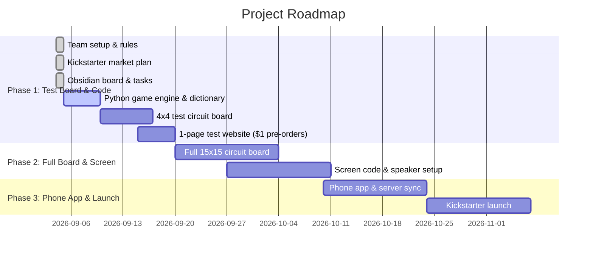

# Project State: Smart Crossword Board

## Current Phase
**Phase 1: Test Board and Game Engine**

---

## Roadmap

---

## Decisions Log

| ID | Date | Topic | Decision & Reason |
| :--- | :--- | :--- | :--- |
| **ADL-001** | 2026-09-04 | Tile Sensors | **15x15 NFC sensor grid**: Reads all 100 wooden letter tiles through solid wood without wires or camera arms. |
| **ADL-002** | 2026-09-04 | Who Plays | **Parent on board, family on phone**: Lets family play together from anywhere without forcing older players to use an app. |
| **ADL-003** | 2026-09-04 | Screen & Voice | **Built-in screen & speaker**: Announces moves out loud and shows letters on screen so older players never need a phone. |
| **ADL-004** | 2026-09-04 | Power & Spin | **Turntable with battery backup**: Spins smoothly on ball bearings; stays plugged in with a magnetic cable or runs 4 hours on battery. |
| **ADL-005** | 2026-09-04 | How to Launch | **Kickstarter campaign**: Sell pre-orders to adult kids looking for a gift for their parents to fund the first production run. |
| **ADL-006** | 2026-09-04 | Checking Demand | **$1 pre-order deposits**: Get 750 $1 deposits and keep ad cost under $2.50 per email before ordering production boards. |
| **ADL-007** | 2026-09-04 | Project Tracking | **Obsidian (Canvas & Task list)**: Keeps all notes and tasks in simple Markdown files on your computer with a visual whiteboard. |

---

## Next Tasks
1. Write the Python game engine and dictionary checker (`firmware/` & `tests/`).
2. Design the 4x4 test circuit board in KiCad (`hardware/`).
3. Build the 1-page test website with $1 pre-order button (`software/`).
