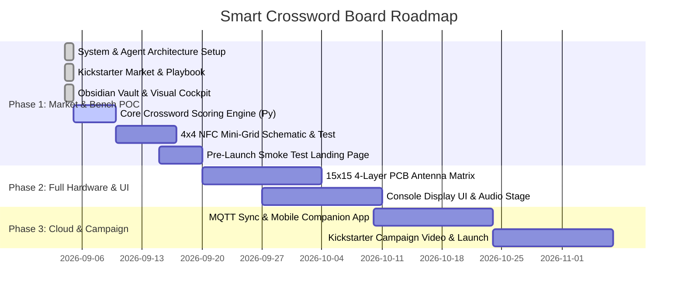

# PROJECT_STATE.md - Smart Crossword Board

## Current Project Phase
**Phase 1: Architecture Definition & Bench Validation (4x4 Matrix POC)**

---

## Active Milestones & Roadmap

---

## Architectural Decisions Log (ADL)

| Decision ID | Date | Subject | Decision & Rationale |
| :--- | :--- | :--- | :--- |
| **ADL-001** | 2026-09-04 | Core Technology | **15x15 Multiplexed 13.56 MHz RFID/NFC Matrix**: Senses 100 letter tiles accurately through solid wood veneer without visible contact pins or camera towers. |
| **ADL-002** | 2026-09-04 | User Experience | **Intergenerational Play (Senior on Physical Board <--> Family on Mobile App)**: Solves senior loneliness, cognitive preservation, and screen fatigue; high gift appeal for adult children. |
| **ADL-003** | 2026-09-04 | Console Architecture | **Fully Standalone Console with High-Contrast Display & Audio**: Large fonts and spoken move announcements directly on the board chassis; senior never needs a smartphone to play. |
| **ADL-004** | 2026-09-04 | Power & Form Factor | **Hybrid Always-On Turntable**: Sits on a ball-bearing lazy-susan with magnetic power dock on the coffee table + internal Li-ion battery for uncorded dining table play. |
| **ADL-005** | 2026-09-04 | Go-To-Market | **Kickstarter Crowdfunding Campaign**: Emotional storytelling video targeting adult children looking for a meaningful gift for aging parents; pre-funds initial production batch. |
| **ADL-006** | 2026-09-04 | Commercial Validation | **$1 VIP Reservation Funnel & $100 Smoke Test**: Build 750+ $1 VIP deposits prior to public Kickstarter launch; enforce $\le \$2.50$ Cost Per Lead before committing high-volume PCB orders. |
| **ADL-007** | 2026-09-04 | Tooling & Visualization | **Obsidian Git-Native Cockpit (JSON Canvas + Kanban)**: Zero cloud lock-in; live bi-directional filesystem synchronization between AI agent code generation and interactive visual whiteboard. |

---

## Next Tasks
1. Implement the reference Python Crossword Engine & Trie dictionary validator (`firmware/` & `tests/`).
2. Design the KiCad schematic for the 4x4 NFC bench test board (ST25R3916 / PN532 + 74HC4067 multiplexer) in `hardware/`.
3. Set up the 1-page pre-launch landing page wireframe and Meta ad assets.
