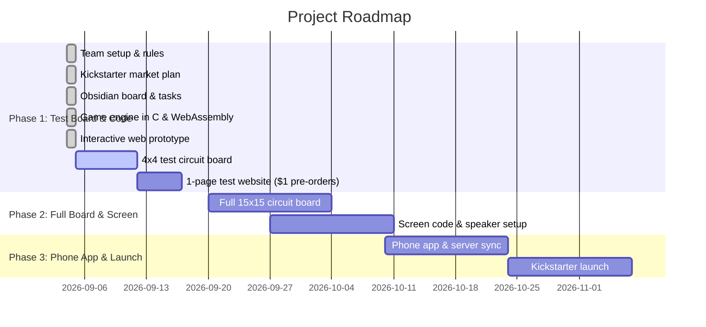

# Project State: Smart Crossword Board

## Current Phase
**Phase 1: Test Board and Game Engine**

---

## Roadmap

---

## Decisions Log

| ID | Date | Topic | Decision & Reason |
| :--- | :--- | :--- | :--- |
| **ADL-001** | 2026-09-04 | Tile Sensors | **15x15 NFC sensor grid**: Reads all 100 wooden letter tiles through solid wood without wires or camera arms. |
| **ADL-002** | 2026-09-04 | Who Plays | **Parent on board, family on phone**: Lets family play together from anywhere without forcing older players to use an app. |
| **ADL-003** | 2026-09-04 | Screen & Voice | **Built-in screen & speaker**: Announces moves out loud and shows letters on screen so older players never need a phone. |
| **ADL-004** | 2026-09-04 | Power & Spin | **Turntable with battery backup**: Spins smoothly on ball bearings; stays plugged in with a magnetic cable or runs 4 hours on battery. |
| **ADL-005** | 2026-09-04 | How to Launch | **Kickstarter campaign**: Sell pre-orders to adult kids looking for a gift for their parents to fund the first production run. |
| **ADL-006** | 2026-09-04 | Checking Demand | **$1 pre-order deposits**: Get 750 $1 deposits and keep ad cost under $2.50 per email before ordering production boards. |
| **ADL-007** | 2026-09-04 | Project Tracking | **Obsidian (Canvas & Task list)**: Keeps all notes and tasks in simple Markdown files on your computer with a visual whiteboard. |
| **ADL-008** | 2026-09-04 | Game Engine Architecture | **Portable C Shared Core (WebAssembly + ESP32)**: Write core Scrabble rule checks and scoring once in clean C with zero OS dependencies; compiles to `engine.wasm` for web and compiles directly to ESP-IDF firmware for the physical board. |
| **ADL-009** | 2026-09-04 | Multi-Language Support | **5 Official Tournament Languages**: Built-in support for English (ENABLE1, 168k words), French (ODS8, 402k words), Dutch (OpenTaal, 337k words), German (Scrabble DE, 590k words), and Spanish (FISE, 635k words), with official tile distributions, language-specific letter scoring, and localized voice synthesis referee announcements. |

---

## Next Tasks
1. Design the 4x4 test circuit board in KiCad (`hardware/`).
2. Build the 1-page test website with $1 pre-order button (`software/`).
3. Connect physical NFC multiplexing bench driver to C engine.
