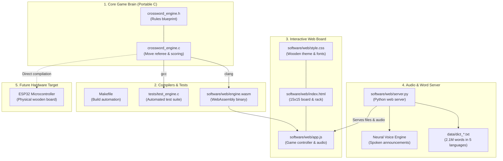

# Software Architecture & Code Overview

This document explains how the software is organized, how each piece connects, and what each file does.

---

## 1. How the Pieces Fit Together

---

## 2. File Explanations (What Each File Does)

### Core Game Brain (`firmware/engine/`)

* **`crossword_engine.h`**
  * The header file that defines the contracts and rules for the whole game.
  * Sets the board dimensions (15x15), maximum tiles per turn (7), the five supported languages (English, French, Dutch, German, Spanish), and tile placement data structures.
  * Declares the referee functions that any platform (microcontroller or web) can call.

* **`crossword_engine.c`**
  * The actual referee and scoring engine, written in pure standard C with zero external operating system dependencies.
  * Checks move validity: enforces covering the center star on turn 1, placing tiles in a single line, allowing no internal gaps, and connecting to existing tiles.
  * Calculates official scores using language-specific letter values (e.g. French W = 10, Dutch C = 5, German Ä = 6, Spanish Ñ = 8) and board bonus squares (double/triple letter, double/triple word, and 50-point bingo bonus).
  * Contains a fast binary search algorithm for looking up words in loaded dictionaries in less than a microsecond.

* **`Makefile`**
  * The build recipe file.
  * Running `make test` compiles the C engine natively with GCC and executes all automated unit tests.
  * Running `make wasm` compiles the exact same C code into WebAssembly (`engine.wasm`) using Clang.

---

### Automated Tests (`tests/`)

* **`test_engine.c`**
  * The automated quality control suite.
  * Tests edge cases without needing a screen: gap detection, off-center turn 1 rejections, L-shape rejections, disconnected moves, interlocking cross-words, and bonus scoring.
  * Loads all 5 real dictionary files and confirms that words like *HELLO*, *BONJOUR*, *FIETS*, *SPIEL*, and *HOLA* are recognized accurately.

---

### Web Board & Simulation (`software/web/`)

* **`engine.wasm`**
  * The compiled WebAssembly binary (under 10 KB).
  * Allows the web browser to run the exact same C engine that will eventually live on the physical microcontroller chip, ensuring 100% identical rules between prototype and final hardware.

* **`index.html`**
  * The visual page structure.
  * Lays out the 15x15 crossword grid, the player's wooden tile rack, the move referee box, the scoreboard (Grandma vs. Phone Player), and top bar controls (language picker, audio toggle, test sound, and new game).

* **`style.css`**
  * The visual design sheet.
  * Implements a realistic wooden board aesthetic with tactile bevels on tiles, high-contrast text for older eyes, large touch-friendly buttons, and responsive sizing.

* **`app.js`**
  * The main frontend controller script.
  * Coordinates board interactions: clicking tiles, placing them on squares, recalling them to the rack, and shuffling.
  * Connects with the Web Audio synthesizer to generate realistic physical sound effects (wooden tile clack, success chimes, and alert buzzers).
  * Automatically switches tile bags, letter point values, and referee languages when a player selects a different language.

* **`server.py`**
  * The lightweight local web and audio server.
  * Serves the HTML, CSS, JavaScript, and dictionary files to the browser.
  * Generates high-definition neural voice audio files on the fly and streams them directly to the browser, so the referee can pronounce words and spell out letters clearly through headphones or speakers.

---

### Official Dictionaries (`data/`)

* **`dict_en.txt`** (English): 168,551 words (ENABLE1 / TWL tournament list).
* **`dict_fr.txt`** (French): 402,325 words (Official Scrabble ODS8 list).
* **`dict_nl.txt`** (Dutch): 337,502 words (OpenTaal tournament list).
* **`dict_de.txt`** (German): 590,751 words (Scrabble Deutschland list).
* **`dict_es.txt`** (Spanish): 635,091 words (FISE international tournament list).
* **Total verified lexicon**: 2,134,220 words.
