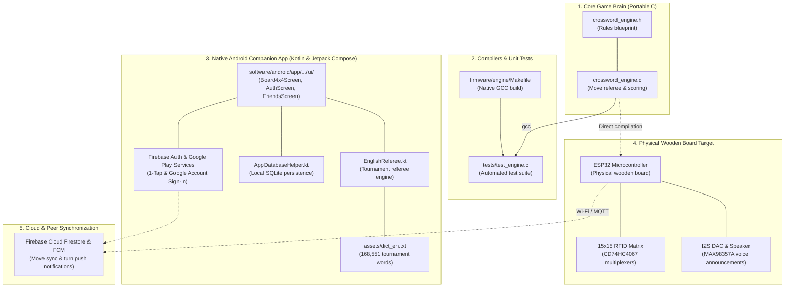

# Software Architecture & Code Overview

This document explains how the software is organized across the physical board firmware and the native Android companion application.

---

## 1. How the Pieces Fit Together

---

## 2. File Explanations (What Each File Does)

### Core Game Brain (`firmware/engine/`)

* **`crossword_engine.h`**
  * The header file that defines the contracts and rules for the game.
  * Sets board dimensions (15x15), maximum tiles per turn (7), supported languages (English, French, Dutch, German, Spanish), and tile placement data structures.
  * Declares referee functions compiled directly to ESP32 firmware.

* **`crossword_engine.c`**
  * The referee and scoring engine, written in pure standard C with zero operating system dependencies.
  * Enforces turn 1 center star coverage, collinearity, internal gap rejection, and tile connectivity.
  * Calculates official scores using language-specific letter values and bonus squares (2L, 3L, 2W, 3W, and 50-point bingo bonus).
  * Implements microsecond binary search for looking up words in loaded tournament lexicons.

* **`Makefile`**
  * The build recipe file.
  * Running `make test` compiles the C engine natively with GCC and executes all automated unit tests.

---

### Automated Tests (`tests/`)

* **`test_engine.c`**
  * Native C automated test suite.
  * Tests edge cases: gap detection, off-center turn 1 rejections, collinearity checks, disconnected moves, interlocking cross-words, and bonus scoring.
  * Verifies word recognition against all 5 official dictionary files.

* **`test_android_agent.py`**
  * Verifies the Android developer agent configuration and tooling bindings.

* **`test_cad_models.py`**
  * Headless FreeCAD automated geometric validation for 3D enclosures.

---

### Native Android Companion App (`software/android/`)

* **`MainActivity.kt`**
  * Root Compose activity managing navigation between tabs: 4x4 Board, Friends & Boards, and Player Account.
  * Handles edge-to-edge layout, session lifecycle, and database resetting.

* **`Board4x4Screen.kt`**
  * Interactive 4x4 hardware prototype test grid with 2W, 3W, 2L, 3L, and center star cells.
  * Digital wooden tile rack (7 tiles), drag/tap placement, recall, shuffle, and real-time referee banner.

* **`EnglishReferee.kt`**
  * Embedded Kotlin Scrabble referee engine.
  * Loads 168,551 official ENABLE1 words from app assets in coroutines.
  * Computes placement validity, bonus multiplier order, and move scores.

* **`AuthScreen.kt`**
  * Authentication screen providing 1-tap instant guest play and Google Account sign-in via Google Play Services and Firebase Auth.

* **`FriendsScreen.kt`**
  * Friend pairing and physical board discovery using unique handles (`sarah#4821`, `board_scb8492`).

* **`AppDatabaseHelper.kt`**
  * Local SQLite persistence (`crossword_companion.db`) storing `users`, `friends`, and `games` with single-session exclusivity.

* **`inspect_db.sh`**
  * Non-root command-line inspector tool to inspect and clear on-device SQLite databases via ADB.

---

### Official Dictionaries (`data/`)

* **`dict_en.txt`** (English): 168,551 words (ENABLE1 / TWL tournament list).
* **`dict_fr.txt`** (French): 402,325 words (Official Scrabble ODS8 list).
* **`dict_nl.txt`** (Dutch): 337,502 words (OpenTaal tournament list).
* **`dict_de.txt`** (German): 590,751 words (Scrabble Deutschland list).
* **`dict_es.txt`** (Spanish): 635,091 words (FISE international tournament list).
* **Total verified lexicon**: 2,134,220 words.
