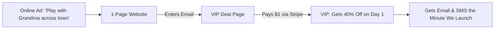

# Pre-Launch Playbook: Getting Backers Before Day 1
**Project**: Smart Crossword Board

---

## 1. The Rule: Fund on Day 1

Kickstarter campaigns do not succeed because of what happens during the 30 days of the campaign. They succeed because of the **60 days of work done before launch**.

If a project hits 100% of its goal within **24 hours**, Kickstarter puts it on the front page and flags it as trending. If it stalls at 20% after two weeks, almost no one sees it.

---

## 2. The $1 Pre-Order Funnel

People who just give their email only back the project **1% to 3%** of the time.
People who pay a **refundable $1 deposit to reserve a spot** back it **25% to 35%** of the time.

### The Math for a $45,000 Goal
* **Target Day 1 Sales**: $45,000
* **Backers Needed (at $199 early bird price)**: 226 buyers.
* **$1 VIPs Needed**: $226 \div 0.30\text{ (30\% conversion)} \approx \mathbf{750\text{ people}}$.
* **Ad Cost per VIP**: Roughly $8.00–$12.00.
* **Total Ad Budget**: ~$6,000–$8,000 (funded through pre-launch deposits and repaid on Day 1).

---

## 3. The $100 Ad Test (Check Demand First)

Before spending big money on prototypes or parts, run a **$100 test**:
1. **Setup**: A simple 1-page website (Carrd or Webflow) + Stripe $1 payment link + Facebook/Instagram ad account.
2. **Budget**: $20/day for 5 days.
3. **Audience**:
   * Countries: US, UK, Canada, Australia.
   * Age: 28–48.
   * Interests: Scrabble, Wordle, Crossword Puzzles, AND family/parents.
4. **Numbers to Watch**:
   * **Click Rate**: Over 1.8% of people who see the ad should click it.
   * **Cost per Email Lead**: Under $2.50 per email.
   * **$1 Deposit Rate**: At least 10% of people who enter their email should put down the $1 deposit.

> [!TIP]
> If an email costs under $2.50, people want this. If it costs over $6.00, change the wording or the photo before building anything.

---

## 4. Ad Examples

### Ad 1: Playing from far away
* **Picture**: Split image. Left: 75-year-old grandmother at home with coffee, moving a wooden tile. Right: 30-year-old daughter on a train with her phone.
* **Headline**: *"Play Scrabble with Grandma every morning—even from 1,000 miles away."*
* **Text**:
  > Calling every day is tough, and older parents hate squinting at small phone screens.
  >
  > The Smart Crossword Board sits in her living room and connects to your phone.
  > She plays real wooden tiles. You play your turn from your phone on the train. The board announces your move, adds up the score, and plays your voice notes out loud.
  >
  > Put down $1 today to reserve 40% off on Kickstarter.

### Ad 2: Real wood instead of screens
* **Picture**: Clean wooden board with clear numbers on the screen, no phone on the table.
* **Headline**: *"The feel of real wood. The ease of playing from anywhere."*
* **Text**:
  > No apps for Mom to install. No passwords to remember. Just a classic wooden board that lets you play your turns from your phone.
  > Keep her mind active and stay in touch every day.

---

## 5. Emails to Send Before Launch

Send an email every 7–10 days so people remember the project:

1. **Email 1 (Right after signing up)**: *Why I Built This* (Brief story of an engineer building this to play with family).
2. **Email 2 (Week 2)**: *How It Works* (Short video showing the turntable and how it reads tiles through wood).
3. **Email 3 (Week 3)**: *Easy for Older Players* (Showing the loud clear voice, big screen, and simple buttons).
4. **Email 4 (3 days before launch)**: *Get Ready* (Tell them the exact day and time we go live so they get the lowest price).
5. **Email 5 (Launch minute)**: *We Are Live!* (Direct link to the Kickstarter page).

---

## 6. Launch Day Plan

* **1 hour before**: Text and email the $1 VIPs with the private link.
* **Launch**: Open 250 early-bird spots at $199.
* **4 hours in**: Post an update when 50% funded.
* **12 hours in**: Announce 100% funded and pitch board game news sites.
* **Day 2**: Announce the first stretch goal (solid walnut wood option).
