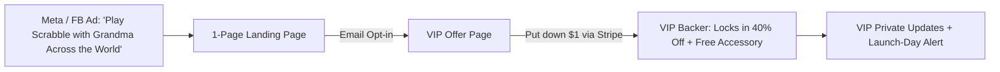

# Pre-Launch Playbook: The $1 VIP Funnel & Audience Building
**Project**: Smart Crossword Board

---

## 1. The Core Philosophy: "Fund on Day 1"

> [!IMPORTANT]
> A Kickstarter campaign does not succeed because of the 30 days it runs. It succeeds because of the **60 days of audience building before it launches**.
> If a campaign reaches 100% funding within **24 hours**, Kickstarter's algorithm labels it "Trending" and "Project We Love", sending a flood of organic backers. If it takes 2 weeks to fund 30%, organic traffic drops to zero.

---

## 2. The $1 VIP Reservation Funnel

Standard email leads convert on Kickstarter at **1.5% to 3%**.
Backers who place a **refundable $1 VIP reservation deposit** convert at **25% to 35%**.

### The Math: Guaranteeing a $45,000 Day-1 Goal
* **Target Day-1 Revenue**: $45,000
* **Target Backers Needed (at $199 Early Bird)**: 226 backers.
* **Required VIP Count**: $226 \div 0.30\text{ (30\% conversion)} \approx \mathbf{750\text{ VIPs}}$.
* **Cost per VIP Lead**: ~$8.00–$12.00 (ad spend to acquire one paying $1 VIP).
* **Pre-Launch Ad Budget Needed**: ~$6,000 – $8,000 (often recouped via Kickstarter payout within 45 days, or can be tested at micro-scale with $100 first).

---

## 3. Phase 0: The $100 "Smoke Test" (Validate Before Spending More)

Before designing production tooling or spending thousands on marketing, run a **$100 micro-test**:
1. **Tooling**: A single Carrd.co or Webflow landing page ($19/year) + Stripe payment link + Meta Ads account.
2. **Budget**: $20/day for 5 days.
3. **Audience Targeting on Meta (Facebook & Instagram)**:
   * **Geography**: US, UK, Canada, Australia.
   * **Age**: 28–48.
   * **Interests**: *Scrabble*, *Words With Friends*, *The New York Times Crossword*, *Wordle*, AND *Elderly Care* or *Grandparenting*.
4. **Key Metrics to Track**:
   * **Click-Through-Rate (CTR)**: Target $\ge 1.8\%$. (If $>2.5\%$, the visual hook is exceptional).
   * **Cost Per Email Lead (CPL)**: Target $\le \$2.50$.
   * **Email-to-VIP Conversion Rate**: Target $\ge 10\%$ of email opt-ins depositing $1.

> [!TIP]
> If CPL is under $2.50, you have green-light statistical validation of market hunger. If CPL is over $6.00, test new headline hooks or imagery before spending any hardware budget.

---

## 4. Meta Ad Creative Templates

### Creative Angle A: The Emotional Distance Hook (Video / Image Carousel)
* **Visual**: Split screen. Left: 75-year-old grandmother smiling over a morning coffee, reaching for a wooden tile. Right: 32-year-old daughter on a commuter train with an iPhone.
* **Headline**: *"Play Scrabble with Grandma every morning—even from 1,000 miles away."*
* **Body Copy**:
  > "You miss her, and she misses you. But calling every day is hard, and she hates squinting at smartphone screens.
  >
  > Meet the Smart Crossword Board: A handcrafted wooden board for her living room, connected directly to your phone.
  > She plays real tactile wooden tiles. You play your turn on the train. The board announces your move, calculates every double-word score, and plays your voice messages out loud.
  >
  > Reserve yours for $1 today to lock in 40% off on Kickstarter."

### Creative Angle B: The Tactile vs. Screen Hook
* **Visual**: Clean wooden board with glowing letter coordinates, zero phone needed on the senior's table.
* **Headline**: *"The warmth of real wood. The magic of staying connected."*
* **Body Copy**:
  > "Zero apps for Mom to download. Zero confusing passwords. Just classic, beautiful wooden tiles that magically know when you take your turn.
  > Keep her mind sharp and your bond strong."

---

## 5. Pre-Launch Email Nurture Sequence (5 Key Emails)

To ensure high launch-day turnout, warm up your email list with updates every 7–10 days:

1. **Email 1 (Immediate upon signup)**: *Welcome & The Origin Story* (How an electromechanical engineer built this to stay close to family).
2. **Email 2 (Day 7)**: *Behind the Craftsmanship* (Showcasing the wooden turntable, raised tile grid, and invisible 15x15 sensor array).
3. **Email 3 (Day 14)**: *The Audio & Senior Usability Features* (Demonstrating the warm voice announcements and high-contrast screen).
4. **Email 4 (3 Days Before Launch)**: *Lock in Your Launch Time* (Announcing the exact launch date & time; reminding VIPs to back within the first hour to guarantee Super Early Bird pricing).
5. **Email 5 (Launch Hour)**: *WE ARE LIVE!* (Direct link to the Kickstarter page).

---

## 6. Launch Day Protocol (Hour 0 to Hour 48)

* **T-Minus 1 Hour**: Send SMS/Email alert to VIP deposit holders with private backer link.
* **T-0 (Launch)**: Open Early Bird tiers (limited to 250 units at $199).
* **T+4 Hours**: Post update celebrating "50% Funded" on social channels and email list.
* **T+12 Hours**: When 100% funded is achieved, submit for Kickstarter "Project We Love" badge and pitch targeted tech/tabletop journalists (*Dicebreaker*, *Gizmodo*, *TechCrunch*, *AARP Bulletin*).
* **T+48 Hours**: Announce first Stretch Goal (e.g. Solid Walnut Wood upgrade).
