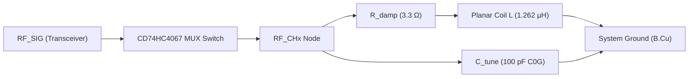

# 13.56 MHz NFC Antenna Theory: Selecting $L$, $C$, and $R$

This document details the electromagnetic and circuit theory used to design the 16-coil antenna matrix for the **Smart Crossword Board** 4x4 test grid. It provides the exact mathematical formulas, physical invariants, and electrical schematics that led to the selection of **$L = 1.262\,\mu\text{H}$**, **$C = 100\,\text{pF}$**, and **$R = 3.3\,\Omega$**.

---

## 1. Electrical Schematic of the Resonant Tank

Each of the 16 squares on the board consists of a planar spiral inductor etched into the top copper layer, paired with an 0603 damping resistor and an 0603 C0G tuning capacitor. 

The CD74HC4067 multiplexer connects the active RF source to one resonant tank at a time:

```text
                                  INDIVIDUAL CELL RESONANT TANK
                      ┌────────────────────────────────────────────────────────┐
                      │                                                        │
                      │               R_damp (3.3 Ω)      Planar Coil (L)      │
                      │               ┌──────────┐        ┌─────────────┐      │
RF_SIG (13.56 MHz)    │     ┌─────────┤ 0603 SMD ├────────┤ 7-Turn PCB  ├──┐   │
       │              │     │         └──────────┘        └─────────────┘  │   │
       ▼              │     │                                              │   │
┌──────────────┐      │     │                                              │   │
│  CD74HC4067  │      │     │                                              │   │
│  Multiplexer ├──────┼─────┤ RF_CHx                                       │   │
│  (Channel x) │      │     │                                              │   │
└──────────────┘      │     │         C_tune (100 pF)                      │   │
                      │     │         ┌──────────┐                         │   │
                      │     └─────────┤ C0G/NP0  ├─────────────────────────┤   │
                      │               └──────────┘                         │   │
                      │                                                    │   │
                      └────────────────────────────────────────────────────┼───┘
                                                                           │
GND Plane (Solid B.Cu return) ─────────────────────────────────────────────┴──── GND
```



* **Parallel Resonance Topology**: The capacitor $C_{\text{tune}}$ is connected in parallel with the series branch ($R_{\text{damp}} + L_{\text{coil}}$). 
* **Circulating Reactive Current**: At the 13.56 MHz resonant frequency, the parallel impedance peaks, creating a high circulating reactive current ($I_{\text{circ}} = Q \cdot I_{\text{in}}$) through the coil turns to project a strong magnetic flux $B_z$ through the 2.0mm–2.5mm wooden top plate.

---

## 2. Step 1: Coil Geometry & Inductance ($L$)

### Physical Dimensions & Trace Definitions ($w$ and $s$)
* **Cell Pitch**: $19.0\,\text{mm} \times 19.0\,\text{mm}$ (matches tournament Scrabble tile size).
* **Coil Outer Dimension ($d_{\text{out}}$)**: $17.5\,\text{mm} \times 17.5\,\text{mm}$ (leaves $0.75\,\text{mm}$ clearance on each side to adjacent cells to prevent magnetic crosstalk).
* **Trace Width ($w = 0.25\,\text{mm} = 10\,\text{mil}$)**: The physical width of the etched copper strip on the top layer (`F.Cu`) that carries the RF current.
* **Trace Spacing / Gap ($s = 0.25\,\text{mm} = 10\,\text{mil}$)**: The clear, unetched dielectric gap (bare FR4) between two adjacent concentric turns of the spiral.
* **Turn Pitch ($p = w + s = 0.50\,\text{mm}$)**: The center-to-center distance between adjacent loops. Each turn reduces the outer dimension by $2p = 1.0\,\text{mm}$ (advancing inward by $0.50\,\text{mm}$ on both sides).

#### Cross-Section Diagram of Adjacent Coil Turns

```text
                     ◄── w ──►         ◄── s ──►         ◄── w ──►
                   ┌───────────┐                       ┌───────────┐
  Top Copper Layer │  Copper   │    Dielectric Gap     │  Copper   │
  (F.Cu, 35 µm)    │   Trace   │   (FR4, no copper)    │   Trace   │
  ═════════════════╧═══════════╧═══════════════════════╧═══════════╧═════════════════
  FR4 Core Substrate (h = 1.6 mm, ε_r = 4.5)
  ─────────────────────────────────────────────────────────────────────────────────
  Bottom Ground Plane (B.Cu solid copper shield return)
                   │◄──────────── Turn Pitch (p = w + s = 0.50 mm) ──────────────►│
```

#### Top-Down Planar View

```text
       ┌───────────────────────────────────────────────────────────┐ ◄── d_out (17.5 mm)
       │  Outer Copper Turn (w = 0.25 mm)                          │
       │  ┌─────────────────────────────────────────────────────┐  │
       │  │  Dielectric Gap / Space (s = 0.25 mm)               │  │
       │  │  ┌───────────────────────────────────────────────┐  │  │
       │  │  │  Turn 2 Copper Trace (w = 0.25 mm)            │  │  │
       │  │  │  ┌─────────────────────────────────────────┐  │  │  │
       │  │  │  │  Turn 3...                              │  │  │  │
       │  │  │  │                                         │  │  │  │
       │  │  │  │        Unwound Center Core              │  │  │  │
       │  │  │  │        ◄─── d_in (11.0 mm) ───►         │  │  │  │
       │  │  │  │                                         │  │  │  │
```

#### Why $w = 0.25\,\text{mm}$ and $s = 0.25\,\text{mm}$ Were Chosen:
1. **PCB Manufacturing Reliability**: JLCPCB standard pooled service supports down to $0.127\,\text{mm}$ ($5\,\text{mil}$). Running at $0.25\,\text{mm}$ ($10\,\text{mil}$) provides a $2\times$ safety margin, guaranteeing 100% etching yield, zero trace bridging, and zero price surcharge.
2. **Skin-Effect Conduction**: At $13.56\,\text{MHz}$, the skin depth is $\delta = 17.7\,\mu\text{m}$. A trace width of $w = 0.25\,\text{mm}$ gives enough perimeter ($2w \approx 0.5\,\text{mm}$) to keep the high-frequency AC resistance down to $R_{\text{AC}} \approx 0.66\,\Omega$.
3. **Low Inter-Turn Parasitic Capacitance**: If spacing $s$ is too tight ($< 0.15\,\text{mm}$), inter-turn capacitive coupling spikes, creating self-resonance too close to $13.56\,\text{MHz}$. At $s = 0.25\,\text{mm}$, inter-turn stray capacitance is negligible ($< 0.5\,\text{pF}$).
4. **Geometric Fit**: $N = 7$ turns requires $7w + 6s = 1.75\,\text{mm} + 1.50\,\text{mm} = 3.25\,\text{mm}$ of copper per edge ($6.5\,\text{mm}$ total across the diameter). This leaves an inner window $d_{\text{in}} = 11.0\,\text{mm}$, allowing magnetic flux lines to pass freely through the center of the coil without Eddy current self-cancellation.

### The Modified Wheeler Inductance Model
For a planar square spiral coil, the inductance $L$ is calculated using the **Modified Wheeler Formula**:

$$L = k_1 \mu_0 \frac{N^2 \cdot d_{\text{avg}}}{1 + k_2 \cdot \rho}$$

Where:
* $\mu_0 = 4\pi \times 10^{-7}\,\text{H/m}$ (magnetic permeability of vacuum).
* $N = 7$ (number of turns).
* $w = 0.25\,\text{mm}$ (copper trace width).
* $s = 0.25\,\text{mm}$ (dielectric space between turns).
* $k_1 = 2.34$ and $k_2 = 2.75$ (empirical coefficients for square geometries).

#### Geometric Derivation:
1. **Inner Diameter ($d_{\text{in}}$)**:
   $$d_{\text{in}} = d_{\text{out}} - 2N w - 2(N - 1)s$$
   $$d_{\text{in}} = 17.5 - (2 \times 7 \times 0.25) - (2 \times 6 \times 0.25) = 17.5 - 3.5 - 3.0 = \mathbf{11.0\,\text{mm}}$$

2. **Average Diameter ($d_{\text{avg}}$)**:
   $$d_{\text{avg}} = \frac{d_{\text{out}} + d_{\text{in}}}{2} = \frac{17.5 + 11.0}{2} = \mathbf{14.25\,\text{mm}} = 0.01425\,\text{m}$$

3. **Fill Ratio ($\rho$)**:
   $$\rho = \frac{d_{\text{out}} - d_{\text{in}}}{d_{\text{out}} + d_{\text{in}}} = \frac{17.5 - 11.0}{17.5 + 11.0} = \frac{6.5}{28.5} \approx \mathbf{0.2281}$$

4. **Resulting Inductance ($L$)**:
   $$L = 2.34 \cdot (4\pi \times 10^{-7}) \cdot \frac{7^2 \cdot 0.01425}{1 + (2.75 \cdot 0.2281)}$$
   $$L = (2.9405 \times 10^{-6}) \cdot \frac{49 \cdot 0.01425}{1 + 0.6272} = (2.9405 \times 10^{-6}) \cdot \frac{0.69825}{1.6272} \approx \mathbf{1.262\,\mu\text{H}}$$

---

## 3. Step 2: Resonant Tuning Capacitor ($C$)

### The Thomson Resonance Formula
The carrier frequency of ISO/IEC 14443 Type A NFC is **$f_0 = 13.56\,\text{MHz}$**. 

The angular frequency is:
$$\omega_0 = 2\pi f_0 = 2\pi \cdot (13.56 \times 10^6) \approx \mathbf{8.520 \times 10^7\,\text{rad/s}}$$

At resonance, the inductive reactance and capacitive reactance cancel each other out ($X_L = X_C$):
$$\omega_0 L = \frac{1}{\omega_0 C_{\text{total}}} \implies C_{\text{total}} = \frac{1}{\omega_0^2 \cdot L}$$

Plugging in our coil inductance $L = 1.262\,\mu\text{H}$:
$$C_{\text{total}} = \frac{1}{(8.520 \times 10^7)^2 \cdot (1.262 \times 10^{-6})} = \frac{1}{(7.259 \times 10^{15}) \cdot (1.262 \times 10^{-6})} = \mathbf{109.2\,\text{pF}}$$

### Factoring in Real-World Parasitics
In a physical multi-layer PCB, $C_{\text{total}}$ is the sum of the discrete capacitor and unavoidable stray parasitic capacitances:
$$C_{\text{total}} = C_{\text{discrete}} + C_{\text{parasitic}}$$

Where $C_{\text{parasitic}}$ originates from:
1. **CD74HC4067 Channel Capacitance**: Typical off/on capacitance $C_D \approx 8.0\,\text{pF}$ to $9.0\,\text{pF}$ on active switch paths.
2. **PCB Trace & Via Capacitance**: Inner-layer microstrip traces over ground planes contribute $\approx 1.2\,\text{pF}$.
$$C_{\text{parasitic}} \approx 8.5\,\text{pF} + 1.2\,\text{pF} \approx \mathbf{9.2\,\text{pF}}$$

### Selected Capacitor Value
$$C_{\text{discrete}} = C_{\text{total}} - C_{\text{parasitic}} = 109.2\,\text{pF} - 9.2\,\text{pF} = \mathbf{100.0\,\text{pF}}$$

* **Standard Nominal Value**: **$100\,\text{pF}$** (E12 / E24 standard).
* **Dielectric Requirement**: **C0G / NP0** (Class 1 ceramic).
  * *Why not X7R?* X7R ceramics change capacitance by up to $\pm 15\%$ across temperature and suffer from piezoelectric microphonics and DC voltage bias shifts. A $10\%$ shift would detune the tank to $14.2\,\text{MHz}$, causing total tag read failure. C0G has zero voltage bias degradation and a temperature coefficient of $0 \pm 30\,\text{ppm/}^\circ\text{C}$.

---

## 4. Step 3: Damping Resistor ($R$) and Quality Factor ($Q$)

### Why $Q$ Cannot Be Too High or Too Low
The Quality Factor ($Q$) dictates the sharpness of resonance and the usable bandwidth of the antenna:

$$Q = \frac{\omega_0 L}{R_{\text{total}}} = \frac{f_0}{\text{Bandwidth } (B)}$$

| Q-Factor | Consequence on 13.56 MHz NFC Operation |
| :--- | :--- |
| **Too High ($Q > 35$)** | **Bandwidth is too narrow.** ISO 14443A uses $106\,\text{kbps}$ ASK modulation with sidebands at $f_0 \pm 848\,\text{kHz}$ ($12.712\,\text{MHz}$ and $14.408\,\text{MHz}$). A high $Q$ chokes these subcarrier sidebands and causes severe ringing, corrupting tag communication. |
| **Too Low ($Q < 15$)** | **Magnetic field is too weak.** Circulating current drops, and the field cannot penetrate through $2.0\,\text{mm} - 2.5\,\text{mm}$ of hardwood. |
| **Target Sweet Spot ($Q = 20 - 25$)** | Optimal magnetic field strength with clean $848\,\text{kHz}$ sideband transmission. |

### AC Resistance of the Copper Trace (Skin Effect)
At $13.56\,\text{MHz}$, electrical current does not flow through the entire $35\,\mu\text{m}$ ($1\,\text{oz}$) thickness of the copper trace; it crowds into the outer surface due to the **Skin Effect**.

1. **Skin Depth in Copper ($\delta$)**:
   $$\delta = \sqrt{\frac{\rho_{\text{cu}}}{\pi f_0 \mu_0}} = \sqrt{\frac{1.68 \times 10^{-8}}{\pi \cdot (13.56 \times 10^6) \cdot (4\pi \times 10^{-7})}} \approx \mathbf{17.7\,\mu\text{m}}$$

2. **Total Trace Length ($l$)**:
   $$l \approx 4 \cdot N \cdot d_{\text{avg}} = 4 \cdot 7 \cdot 0.01425\,\text{m} = \mathbf{0.399\,\text{m}} \approx 40\,\text{cm}$$

3. **High-Frequency AC Resistance ($R_{\text{AC}}$)**:
   $$R_{\text{AC}} \approx \frac{\rho_{\text{cu}} \cdot l}{2 \cdot (w + \delta) \cdot \delta} \approx \frac{(1.68 \times 10^{-8}) \cdot 0.399}{2 \cdot (0.25 \times 10^{-3} + 17.7 \times 10^{-6}) \cdot (17.7 \times 10^{-6})} \approx \mathbf{0.66\,\Omega}$$

4. **Unloaded Q-Factor (Without Damping Resistor)**:
   $$Q_{\text{unloaded}} = \frac{\omega_0 L}{R_{\text{AC}}} = \frac{(8.520 \times 10^7) \cdot (1.262 \times 10^{-6})}{0.66} \approx \mathbf{162.9}$$
   *An unloaded Q of 163 gives a bandwidth of only $83\,\text{kHz}$, which would completely destroy ISO 14443 subcarrier pulses!*

### Calculating Required Damping Resistor ($R_{\text{damp}}$)
To bring the loaded Quality Factor down to our target **$Q_{\text{target}} = 25$**:

1. **Required Total Loop Resistance ($R_{\text{total}}$)**:
   $$R_{\text{total}} = \frac{\omega_0 L}{Q_{\text{target}}} = \frac{(8.520 \times 10^7) \cdot (1.262 \times 10^{-6})}{25} \approx \mathbf{4.30\,\Omega}$$

2. **Loop Resistance Budget**:
   $$R_{\text{total}} = R_{\text{AC\_coil}} + R_{\text{MUX\_ON}} + R_{\text{damp}}$$
   Where:
   * $R_{\text{AC\_coil}} \approx 0.66\,\Omega$ (trace skin resistance).
   * $R_{\text{MUX\_ON}} \approx 0.35\,\Omega$ (CD74HC4067 channel on-resistance at RF).
   * $R_{\text{damp}}$ is the discrete resistor.

3. **Solving for $R_{\text{damp}}$**:
   $$R_{\text{damp}} = R_{\text{total}} - R_{\text{AC\_coil}} - R_{\text{MUX\_ON}} = 4.30\,\Omega - 0.66\,\Omega - 0.35\,\Omega = \mathbf{3.29\,\Omega}$$

* **Selected Nominal Value**: **$3.3\,\Omega$** ($1\%$, 0603 SMD).

---

## 5. Summary Specification Table

| Parameter | Theoretical Formula | Target / Calculated | Chosen Physical Component |
| :--- | :--- | :--- | :--- |
| **Resonant Frequency** | $f_0$ | $13.56\,\text{MHz}$ | Industrial ISM Standard (ISO 14443A) |
| **Coil Inductance** | $L = k_1 \mu_0 \frac{N^2 d_{\text{avg}}}{1 + k_2 \rho}$ | **$1.262\,\mu\text{H}$** | 7-Turn Planar Square Spiral ($17.5\text{mm} \times 17.5\text{mm}$) |
| **Total Resonant Capacitance** | $C_{\text{total}} = \frac{1}{\omega_0^2 L}$ | $109.2\,\text{pF}$ | Total LC tank capacitance |
| **Tuning Capacitor ($C$)** | $C = C_{\text{total}} - C_{\text{parasitic}}$ | **$100.0\,\text{pF}$** | **$100\,\text{pF}$ 50V C0G/NP0 0603** (LCSC `C14405`) |
| **Coil AC Resistance** | $R_{\text{AC}} \propto \frac{l}{\delta \cdot w}$ | $0.66\,\Omega$ | Trace skin effect at 13.56 MHz |
| **Target Quality Factor** | $Q = \frac{\omega_0 L}{R_{\text{total}}}$ | **$25.0$** | Optimum for ISO 14443A 848 kHz subcarrier |
| **Damping Resistor ($R$)** | $R_{\text{damp}} = \frac{\omega_0 L}{Q} - R_{\text{AC}} - R_{\text{MUX}}$ | **$3.29\,\Omega$** | **$3.3\,\Omega$ 1% 1/10W 0603** (LCSC `C22971`) |
| **Usable RF Bandwidth** | $B = \frac{f_0}{Q}$ | **$542.4\,\text{kHz}$** | Clear transmission of tag data without distortion |
