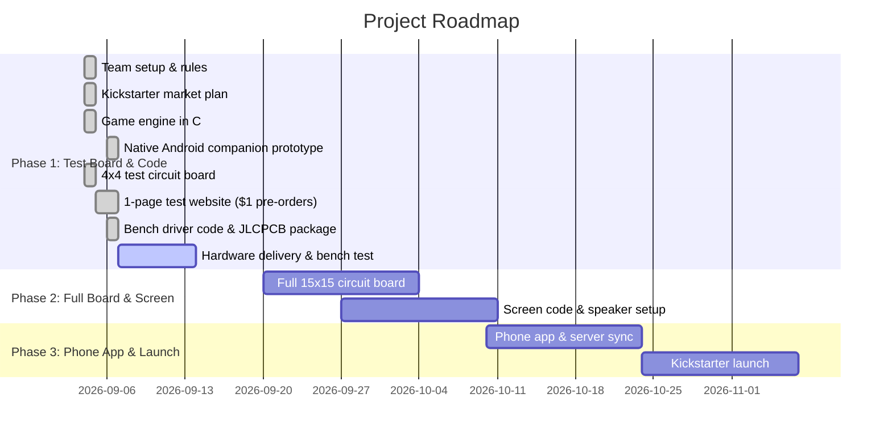

# Project State: Smart Crossword Board

## Current Phase
**Phase 1: Test Board and Game Engine**

---

## Roadmap

---

## Decisions Log

| ID          | Date       | Topic                                                 | Decision & Reason                                                                                                                                                                                                                                                                                                                                                                                                                                                                                                                                                       |
| :---------- | :--------- | :---------------------------------------------------- | :---------------------------------------------------------------------------------------------------------------------------------------------------------------------------------------------------------------------------------------------------------------------------------------------------------------------------------------------------------------------------------------------------------------------------------------------------------------------------------------------------------------------------------------------------------------------- |
| **ADL-001** | 2026-09-04 | Tile Sensors                                          | **15x15 NFC sensor grid**: Reads all 100 wooden letter tiles through solid wood without wires or camera arms.                                                                                                                                                                                                                                                                                                                                                                                                                                                           |
| **ADL-002** | 2026-09-04 | Who Plays                                             | **Parent on board, family on phone**: Lets family play together from anywhere without forcing older players to use an app.                                                                                                                                                                                                                                                                                                                                                                                                                                              |
| **ADL-003** | 2026-09-04 | Screen & Voice                                        | **Built-in screen & speaker**: Announces moves out loud and shows letters on screen so older players never need a phone.                                                                                                                                                                                                                                                                                                                                                                                                                                                |
| **ADL-004** | 2026-09-04 | Power & Spin                                          | **Turntable with battery backup**: Spins smoothly on ball bearings; stays plugged in with a magnetic cable or runs 4 hours on battery.                                                                                                                                                                                                                                                                                                                                                                                                                                  |
| **ADL-005** | 2026-09-04 | How to Launch                                         | **Kickstarter campaign**: Sell pre-orders to adult kids looking for a gift for their parents to fund the first production run.                                                                                                                                                                                                                                                                                                                                                                                                                                          |
| **ADL-006** | 2026-09-04 | Checking Demand                                       | **$1 pre-order deposits**: Get 750 $1 deposits and keep ad cost under $2.50 per email before ordering production boards.                                                                                                                                                                                                                                                                                                                                                                                                                                                |
| **ADL-007** | 2026-09-04 | Project Tracking                                      | **Obsidian (Canvas & Task list)**: Keeps all notes and tasks in simple Markdown files on your computer with a visual whiteboard.                                                                                                                                                                                                                                                                                                                                                                                                                                        |
| **ADL-008** | 2026-09-04 | Game Engine Architecture                              | **Portable C Shared Core (WebAssembly + ESP32)**: Write core Scrabble rule checks and scoring once in clean C with zero OS dependencies; compiles to `engine.wasm` for web and compiles directly to ESP-IDF firmware for the physical board.                                                                                                                                                                                                                                                                                                                            |
| **ADL-009** | 2026-09-04 | Multi-Language Support                                | **5 Official Tournament Languages**: Built-in support for English (ENABLE1, 168k words), French (ODS8, 402k words), Dutch (OpenTaal, 337k words), German (Scrabble DE, 590k words), and Spanish (FISE, 635k words), with official tile distributions, language-specific letter scoring, and localized voice synthesis referee announcements.                                                                                                                                                                                                                            |
| **ADL-010** | 2026-09-04 | Detection Evaluation                                  | **Retain Full Board RFID over Hall Effect**: Evaluated Hall sensors on board + RFID in player rack. Found that Hall sensors only detect presence (not letter identity), creating anagram ambiguity (e.g. STOP vs POST), breaking natural senior play, and increasing total BOM by $15–$25 due to active battery-powered racks. Full 15x15 board RFID remains the optimal design.                                                                                                                                                                                        |
| **ADL-011** | 2026-09-04 | 4x4 Test Circuit Board                                | **KiCad 10 4-layer NFC Matrix**: Built 4x4 test grid with 19mm pitch, 7-turn 17.5mm planar spiral coils (L=1.26µH), 100pF C0G capacitors, 3.3Ω damping resistors (Q=25), and CD74HC4067 multiplexer. Complete with Host header, NFC header, and SMA test port.                                                                                                                                                                                                                                                                                                          |
| **ADL-012** | 2026-09-05 | 4x4 PCB Layout & Routing                              | **Zero-DRC & Zero-Unconnected Routing Pass**: Completed full automated 4-layer PCB routing in KiCad 10. Achieved 0 DRC violations and 0 unconnected items. Invariants enforced: 100% planar coil routing on In2.Cu, concentric SPI & MUX bus corridors, solid ground return on B.Cu, and dedicated RF keepouts under all 16 coils on In1.Cu.                                                                                                                                                                                                                            |
| **ADL-013** | 2026-09-05 | 4x4 CAD Enclosure & Tiles                             | **FreeCAD Python Automation & 3D Printed Prototyping**: Created parametric 3D CAD models for 4x4 test enclosure (Base Tray with M3 screw bosses and header cutouts, Top Grid Faceplate with 1.2mm ribs and 1.5mm RF floor) and NFC Scrabble tile prototypes with 18.5mm coin tag cavities. Integrated automated FreeCAD 1.1 Python headless pipeline and continuous CAD lessons feedback loop.                                                                                                                                                                          |
| **ADL-014** | 2026-09-05 | Tile & RFID Sourcing Strategy                         | **15mm NTAG213 Tags & Localized Single-Language Fulfillment**: Selected 15mm NTAG213 paper stickers ($0.035 ea, CXJ RFID) over 12mm (56% larger loop area, 12–14mm read depth). Adopted custom beechwood tiles with 15.5mm × 0.8mm milled cavities (Panda/LongPack) at $2.20/set. Enforced single localized 100/102-tile bag per box selected in backer survey, with extra languages sold as $25 Kickstarter add-on packs. Total tile subsystem BOM: $6.52.                                                                                                             |
| **ADL-015** | 2026-09-05 | Web Sourcing & Link Verification                      | **Local-First Search Hierarchy & Automated Live Link Verification Engine**: Established Web Sourcing Scout (`web_sourcing`) and automated verification tool (`scripts/verify_ecommerce_links.py`). Sourcing priority order: Amazon Belgium (`amazon.com.be`) first, followed by immediate EU neighbors (France, Germany) and specialized regional platforms (Bol.com, ShopNFC). Enforced invariant FAIL-010: all cited links must be validated live with modern browser headers for HTTP 200, in-stock status, and real EUR pricing to eliminate phantom or dead links. |
| **ADL-016** | 2026-09-06 | DataLoom Sourcing Tables & BOM Sync                   | **Native DataLoom Spreadsheets & Top Candidate Sync**: Generated Obsidian DataLoom (`.loom`) files validated through DataLoom's internal deserializer. Updated `Prototype_4x4_Shopping_List.md` (€69.47 allocated bench cost / €125.47 pack checkout total) and `Production_15x15_Sourcing_List.md` ($67.87 BOM per unit) with top-ranked candidates across all categories (including 3.5" touch LCD, turntable bearing, I2S DAC amp, and mini speaker).                                                                                                                |
| **ADL-017** | 2026-09-06 | PWA Retirement & Native Android Migration             | **PWA Webapp Retired (Superseded by ADL-018/ADL-019)**: Evaluated webapp/PWA companion prototype. Retired in favor of full native Android companion app (Kotlin, Jetpack Compose, Room/SQLite, Google Play Services & Firebase Auth) to leverage native Bluetooth Low Energy (BLE), hardware-accelerated gestures, local-first offline SQLite, and deeper OS integration.                                                                                                                                                                                               |
| **ADL-018** | 2026-09-06 | Native Android 4x4 Companion App                      | **Kotlin & Jetpack Compose 4x4 Prototype with Local-First SQLite**: Built first viable native Android app (`software/android/`) with Kotlin, Jetpack Compose, Material 3, and Gradle 9.1 / Java 25. Features: interactive 4x4 test grid with 2W, 3W, 2L, 3L bonus logic, English Scrabble referee, 1-tap Google account auth, local-first SQLite persistence (`AppDatabaseHelper`), unique username friend system (`name#1234`), and continuous learning protocol (`android_lessons.md`).                                                                               |
| **ADL-019** | 2026-09-06 | Android Firebase Google Auth & Hardware Testing       | **Firebase Auth, Database Inspector, and On-Device Testing Suite**: Connected Android Companion to Firebase `smart-crossword-2177f` with Play Services OAuth Web Client ID and SHA-1 registration. Created `software/android/inspect_db.sh` for non-root ADB SQLite inspection and reset. Implemented 15 JVM unit tests (`RefereeTest`, `FirebaseConfigTest`) and 6 on-device instrumented hardware tests (`AppDatabaseDeviceTest`) verified passing on physical OnePlus 7T Pro.                                                                                        |
| **ADL-020** | 2026-09-06 | Documentation Folder Reorganization & Git Remote Sync | **Repository Root Clean-up into `docs/` and Mandatory Remote Push**: Moved 15 root-level canvas markdown/loom documents into dedicated `docs/` directory (`docs/PROJECT_STATE.md`, `docs/Project_Tasks.md`, etc.), preserving clean root vault structure in Obsidian. Updated `Project_Cockpit.canvas` file node paths. Enforced Rule 8 in `AGENTS.md` and Invariant 7 in `wise.md` requiring immediate `git push origin main` after every commit.                                                                                                                      |
| **ADL-021** | 2026-09-06 | 4x4 PCB & Shopping List Hardware Compatibility Sync   | **4x4 Prototype PCB & Shopping List Compatibility Validation**: Audited all 12 items in `Prototype_4x4_Shopping_List.md` against `test_grid_4x4.kicad_pcb`. Confirmed 100% compatibility for wooden Scrabble tiles (19.0mm pitch), NTAG213 tags (13.56 MHz LC resonance), ESP32-S3 host (3.3V logic, J1 header), turntable bearing (71x71mm), 3.5" TFT display, I2S DAC amp, and M3 fasteners. Synchronized schematic `test_grid_4x4.kicad_sch` to match the perfected zero-DRC pin layout of `test_grid_4x4.kicad_pcb`. Documented practical integration notes for CD74HC4067 multiplexer (SOIC-24 PCBA vs Amazon DIP breakout) and PN532 V3 transceiver (SMA RF link). Added FAIL-011 to Wise. |
| **ADL-022** | 2026-09-06 | 13.56 MHz LC Resonant Selection & Antenna Theory      | **Antenna Resonance & Q-Damping Theoretical Derivation**: Documented complete electromagnetic and circuit theory in `docs/LC_Resonance_and_Antenna_Theory.md` and added theoretical section to `Project_Cockpit.canvas`. Derived coil inductance $L = 1.262\,\mu\text{H}$ via Modified Wheeler model (N=7 turns, 17.5mm square, 0.25mm trace/space). Derived tuning capacitor $C = 100\,\text{pF}$ C0G from Thomson formula ($109.2\,\text{pF}$ total minus $9.2\,\text{pF}$ multiplexer/PCB parasitics). Derived damping resistor $R = 3.3\,\Omega$ to fix loaded Quality Factor at $Q = 25$ ($542\,\text{kHz}$ bandwidth) to preserve ISO 14443A 848 kHz subcarrier sidebands. |
| **ADL-023** | 2026-09-06 | Engineering Truth & Anti-Fudging Invariant            | **Zero Fudging & Mandatory Physical Rigor**: Enforced non-negotiable Rule 9 in `AGENTS.md`, Invariant 8 in `wise.md`, and FAIL-012 prohibiting the fabrication of fake numbers or justifications (such as fudging parasitic capacitance to neatly match standard 100 pF components). Mandated that all physical discrepancies, component tolerances ($\pm 5\%$), and detuning effects must be analyzed with honest operating margins ($Q=25$, $542\,\text{kHz}$ bandwidth, tag frequency pull, and PN5180 250mW power headroom) to build physical hardware that actually works. |
| **ADL-024** | 2026-09-06 | 4x4 JLCPCB SMT Package, ESP32 Driver & Pre-Launch Funnel | **JLCPCB SMT Package, Firmware Bench Driver & 1-Page Pre-Launch Funnel**: Prepared full JLCPCB manufacturing package (`bom_jlcpcb.csv`, `cpl_jlcpcb.csv`, `JLCPCB_ORDERING_GUIDE.md`) with LCSC parts matching for automated assembly. Built complete ESP32-S3 bench driver suite (`firmware/esp32_driver/`) with CD74HC4067 MUX control, PN532 SPI driver, tile mapper, and tournament crossword referee bridge with 100% automated test pass (1.18ms sweep latency vs 40ms ceiling). Built responsive 1-page pre-launch landing page (`software/web/`) for $1 VIP pre-orders and $100 ad test funnel. |
| **ADL-025** | 2026-09-13 | Visual Progression Web Cockpit & Bidirectional Disk Sync | **React 18 + Vite + @xyflow/react Web Cockpit**: Created interactive web progression dashboard (`software/cockpit/`) featuring Infinite Canvas matching Obsidian, Gantt roadmap with 25 ADL decision entries, and high-performance Kanban board with `content-visibility: auto`. Integrated Vite server middleware for live bidirectional reads/writes to `Project_Cockpit.canvas` and `docs/Project_Tasks.md`. |
| **ADL-026** | 2026-09-14 | Physical Bench Bring-Up & 4x4 MUX Verification | **Physical Hardware Validation (ESP32-S3 + PN532 + 4x4 Test Grid PCB)**: Verified PN532 SPI communication on ESP32-S3 at 3.3V (Pins SCK=12, MOSI=13, MISO=21, CS=14, RST=11). Validated CD74HC4067 SOIC-24 SMD multiplexer footprint and active channel switching under firmware control. Clarified physical horizontal orientation of Header J1 and documented voltage divider behavior of planar RF coils under DC testing (FAIL-014). |
| **ADL-027** | 2026-09-15 | Kickstarter Launch Strategy & Campaign Copy | **Hero Prototype First Strategy & Kickstarter Campaign Page**: Formulated commercial launch doctrine: enforce full-sized 15x15 "Hero" prototype with real wood finish and turntable before campaign launch rather than launching with a bare 4x4 bench circuit board. Concurrently execute the $1 pre-launch VIP reservation funnel to secure 750 deposit holders ($45,000 Day 1 funding guarantee). Penned complete Kickstarter campaign copy (`commercial/kickstarter_campaign_page.md`) with 90s video storyboard, "Who buys vs who plays" hook, transparent prototype proof, and tiered pricing ($199 Super Early Bird). Updated `Project_Cockpit.canvas`. |
| **ADL-028** | 2026-09-15 | Android BLE Stack & Real-Time Radar Scanner | **BLE GATT Server on ESP32-S3 & Android Live Radar Visuals**: Built native Android BLE engine (`BleManager.kt`) and ESP32-S3 BLE GATT Server (`SmartCrossword_4x4`, Service `19B10000-...`) with custom protocol: `BOARD_STATE` (16-byte notify), `SCAN_TELEMETRY` (2-byte notify), and `BOARD_COMMAND` (write). Designed and verified real-time visual scanning feedback in Jetpack Compose (`Board4x4Screen.kt`): animated cyan/amber radar pulse on actively energized antenna square, instant physical tile drop-in animation with referee validation, and board link control bar. Verified over-the-air 16-channel telemetry stream with python Bleak (`scripts/test_ble_link.py`) and 100% passing JVM tests. |
| **ADL-029** | 2026-09-15 | Persistent BLE Link, Coil Power Debugger & Tag Enrollment | **Hoisted BLE Architecture, 4x4 Power Control & Piece Registration Studio**: Hoisted `BleManager` singleton to `MainActivity` with auto-reconnect background timer, resolving connection drops across `Friends` and `Account` navigation tabs. Expanded BLE protocol: telemetry packs physical tag UID (`[ch, status, len, uid0..6]`), commands add `0x03` (Channel Select), `0x04` (Toggle MUX), and `0x05` (Enroll Tag). Created `HardwareDebugScreen.kt` featuring 4x4 matrix coil power controls (manual square energizing 0..15, prev/next stepping, sweep) and Piece Registration Studio (detects physical tag UID, assigns A–Z with Scrabble point weights, and sends enrollment command). Verified end-to-end on ESP32-S3 over-the-air with Python Bleak (`scripts/test_ble_link.py`) and passing JVM unit tests (`BleProtocolTest`). |
| **ADL-030** | 2026-09-15 | RF Debounce Hysteresis, Standalone Transceiver Polling & Latching Telemetry | **Anti-Thrashing Telemetry & RF Stability Invariants**: Resolved transient tag read dropouts across hardware and app: 1) Implemented 3-consecutive-miss debounce (~450ms) in ESP32 firmware before declaring tags absent; 2) Ungated PN532 single-channel polling from downstream `muxEnabled` switches; 3) Implemented latching tag UID state in `BleManager` across periodic 400ms radar pulses (`STATUS_ENERGIZED`); 4) Updated `HardwareDebugScreen.kt` to check composite presence (`telemetry.status`, `tagUid`, and `boardState`) and support unregistered tag visualization (`'?'`). Documented FAIL-018, FAIL-019, FAIL-020, and LESSON-AND-014. |
| **ADL-031** | 2026-09-15 | Persistent Tile Registration & Local App Database | **Dual-Tier Tile Persistence (ESP32 NVS + Android SQLite) & BLE Auto-Sync**: Guaranteed tile registrations survive ESP32 firmware reflashes and power cycles: 1) Expanded ESP32 tag capacity to 128 and implemented non-volatile persistence via `<Preferences.h>`, reloading registered tags on boot; 2) Added persistent `TABLE_TILES` in Android local SQLite (`AppDatabaseHelper.kt` schema v2); 3) Added `CMD_SYNC_TILE (0x06)` BLE command for direct UID provisioning; 4) Implemented auto-sync on BLE connect and instant auto-healing of unregistered tags (`'?'`); 5) Added Tile Database management card in `HardwareDebugScreen.kt`. |
| **ADL-032** | 2026-09-15 | Android SQLite Connection Pool & Concurrency Hardening | **Android SQLite Helper Concurrency Fix**: Resolved intermittent app crashes (`IllegalStateException: connection pool has been closed` / `attempt to re-open an already-closed object`) caused by Kotlin's `.use { db -> ... }` closing the shared `SQLiteDatabase` connection pool inside `AppDatabaseHelper.kt`. Left database lifecycle management to `SQLiteOpenHelper` while strictly closing `Cursor` instances via `cursor.use { ... }`. Verified 100% pass on 15 JVM unit tests and 10 on-device hardware instrumented tests on physical OnePlus 7T Pro. Documented LESSON-AND-016 and FAIL-022. |
| **ADL-033** | 2026-09-15 | Bidirectional Tag Auto-Ingestion & Reactive StateFlow | **Bidirectional Dual-Tier Auto-Ingest**: Resolved missing tiles in companion app where tiles enrolled in ESP32 NVS were not imported into phone's SQLite DB: 1) Implemented inbound auto-ingest in `BleManager` across telemetry and board state updates: any recognized tile ('A'..'Z') scanned with a tag UID is automatically saved to SQLite; 2) Exposed `registeredTiles: StateFlow<List<TileRecord>>` to reactively drive Compose UI in real time; 3) Updated `inspect_db.sh` to display the `tiles` table. Documented LESSON-AND-017 and FAIL-023. |
| **ADL-034** | 2026-09-16 | ESP32-S3 USB CDC Console Reliability & Onboard RGB LED Feedback | **Console DTR Fix & NeoPixel Status Visualizer**: Resolved silent console output in `pio monitor` and lack of hardware connection visibility: 1) Added `monitor_dtr = 1` and `monitor_rts = 0` to `platformio.ini` to assert CDC DTR line; 2) Added dynamic terminal attach detection (`bool(Serial)`) in `main.cpp` that automatically refreshes the ASCII dashboard whenever a monitor connects; 3) Integrated onboard WS2812 RGB LED (`RGB_BUILTIN` / GPIO 48) providing real-time hardware status: Solid Green = PN532 Connected, Blinking Amber = Searching/Offline, Soft Cyan = App Connected, Bright Cyan/White = Tag Detected on Square; 4) Fixed Enter key double-stepping on CRLF. Documented FAIL-024. |

---

## Next Tasks
1. Receive U.FL / IPEX coax pigtail cable and remove the two 0Ω bridges on PN532 to link 13.56 MHz RF directly to 4x4 PCB Port J3.
2. Receive 15mm NTAG213 stickers and test tile UID enrollment and letter mapping with the core dictionary engine.
3. Bench test multi-channel 16-coil scanning latency (< 40ms) and tag read height through 3D printed / wood top faceplate.
4. Field test native Android companion app against physical board moves.

