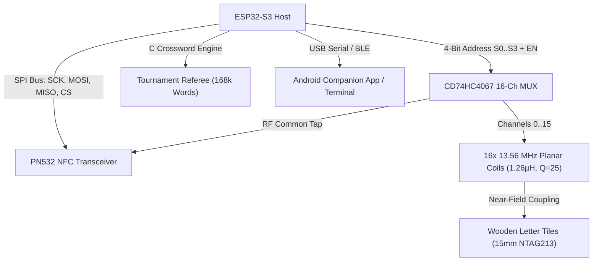

# ESP32-S3 4x4 Bench Driver

This firmware driver runs on the **ESP32-S3 DevKitC-1** host microcontroller to control the **4x4 NFC Test Grid** (`hardware/kicad/test_grid_4x4/`).

---

## 1. System Architecture



---

## 2. Pin Mapping (Header J1)

| Signal | ESP32-S3 Pin | J1 Header Pin | Description |
| :--- | :--- | :--- | :--- |
| **+3.3V** | `3V3` | Pins 1, 2 | Power rail |
| **GND** | `GND` | Pins 13, 15, 17, 19 | Ground reference |
| **MUX_S0** | `GPIO 15` | Pin 11 | Multiplexer address bit 0 (LSB) |
| **MUX_S1** | `GPIO 7` | Pin 9 | Multiplexer address bit 1 |
| **MUX_S2** | `GPIO 5` | Pin 5 | Multiplexer address bit 2 |
| **MUX_S3** | `GPIO 4` | Pin 3 | Multiplexer address bit 3 (MSB) |
| **MUX_EN** | `GPIO 6` | Pin 7 | Multiplexer enable (active LOW) |
| **NFC_IRQ** | `GPIO 10` | Pin 10 | PN532 data ready interrupt |
| **NFC_RST** | `GPIO 11` | Pin 12 | PN532 hardware reset |
| **SPI_SCK** | `GPIO 12` | Pin 18 | SPI Clock |
| **SPI_MOSI**| `GPIO 13` | Pin 14 | SPI Master Out Slave In |
| **SPI_CS** | `GPIO 14` | Pin 16 | SPI Chip Select |
| **SPI_MISO**| `GPIO 21` | Pin 20 | SPI Master In Slave Out |

---

## 3. How to Build & Run Tests

### Native Simulation (Host Machine)
You can compile and run the full driver logic, scan simulation, and word referee on your Linux workstation without any physical hardware attached:

```bash
cd firmware/esp32_driver
make test
```

Expected output:
* 168,551 words loaded into Trie/binary search engine.
* Simulated placement of word `P-L-A-Y` detected on row 1.
* Referee confirms `PLAY` is a valid word scoring 9 points.
* 50 consecutive sweeps benchmarked under **1.2 ms total sweep latency** (well below the 40 ms ceiling).
* Tile removal detected in real time.

### Deploying to ESP32-S3 Hardware
When your ESP32-S3 board arrives:
1. Connect via USB-C cable.
2. In ESP-IDF: `idf.py build flash monitor` (or compile via PlatformIO).
3. The board outputs 115200 baud serial logs of active scans.
