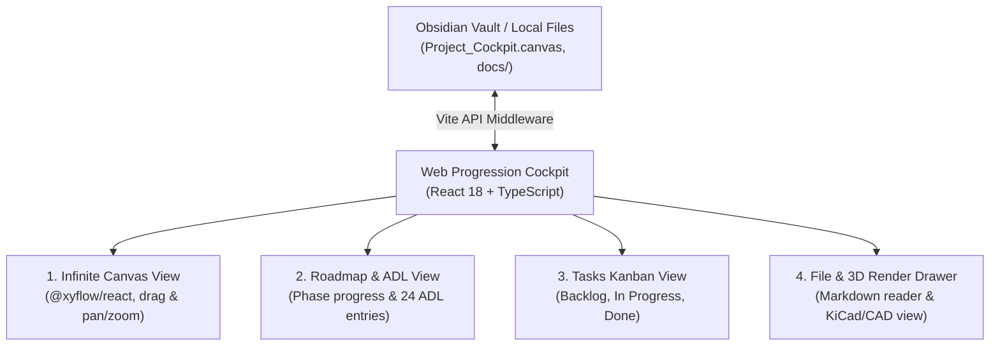

# Smart Crossword Board — Progression Cockpit

A fast, interactive visual web dashboard to follow and manage project progression, featuring an Infinite Canvas matching Obsidian, a Gantt Roadmap with the Architectural Decisions Log, and an interactive Kanban task board with live bidirectional disk synchronization.

---

## 1. Features & Architecture



### 1.1 Multi-View Dashboard
1. **Infinite Canvas View**:
   - Renders `Project_Cockpit.canvas` with `@xyflow/react`.
   - Supports pan, zoom, minimap, controls, and search filtering across hardware, CAD, software, and commercial domains.
   - Live custom node types:
     - Group containers with Obsidian color badges.
     - Text note cards with markdown and math formatting.
     - Document cards with one-click inspection drawer.
     - Hardware 3D render preview cards (KiCad PCB 3D ISO, CAD assembly, base tray, grid plate).
   - **Bidirectional Drag & Drop**: Moving cards automatically debounces and saves updated `(x, y)` positions back to `Project_Cockpit.canvas`.

2. **Roadmap & Decisions (ADL) View**:
   - Current phase banner: **Phase 1: Test Board and Game Engine**.
   - 3-Stage Gantt milestones tracker.
   - Searchable & filterable **Architectural Decisions Log (ADL-001 to ADL-024)** table with direct technical reasons.

3. **Tasks Kanban View**:
   - 3 columns: 📋 Backlog, ⏳ In Progress, ✅ Done.
   - High-performance isolated layout using `content-visibility: auto` per modern web standards.
   - Interactive checkboxes and arrow buttons to move tasks between stages.
   - Debounced auto-save writing directly to `docs/Project_Tasks.md`.

4. **File & 3D Render Drawer**:
   - Slide-over inspection drawer to read any project markdown document or zoom into KiCad/CAD 3D renders without leaving the page.

---

## 2. Getting Started

### Prerequisites
- Node.js >= 18
- npm >= 9

### Development Server
Run from `software/cockpit/`:

```bash
npm install
npm run dev
```

Then open `http://localhost:5173` in your browser.

### Production Build
```bash
npm run build
```

---

## 3. Live Disk Endpoints

The integrated Vite server middleware provides the following endpoints:

| Route | Methods | Description |
| :--- | :--- | :--- |
| `/api/canvas` | `GET`, `PUT` | Reads and writes `Project_Cockpit.canvas` preserving node positions and edge links. |
| `/api/tasks` | `GET`, `PUT` | Reads and writes `docs/Project_Tasks.md` with markdown checklist preservation. |
| `/api/state` | `GET` | Extracts phase, stages, and the decisions table from `docs/PROJECT_STATE.md`. |
| `/api/file?path=...` | `GET` | Safely streams repository files (markdown text or PNG 3D renders). |

---

## 4. Theme & Ergonomics

Designed in **Clean Engineering Light Mode**:
- Slate surface (`#f8fafc`) with subtle blueprint dots (`#cbd5e1`).
- High-contrast white cards (`#ffffff`) with crisp slate borders (`#e2e8f0`).
- Monospace technical metrics (`JetBrains Mono`).
- Visual sync indicator showing real-time disk status (`● Saved to disk` / `● Saving...`).
