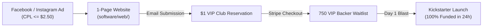

# 1-Page Pre-Launch Landing Page & VIP Funnel

This is the high-converting pre-launch landing page for the **Smart Crossword Board** project, implementing the strategy from [`commercial/prelaunch_playbook.md`](../../commercial/prelaunch_playbook.md).

---

## 1. Funnel Architecture



---

## 2. Key Features

* **High-Contrast Senior & Gift-Buyer Messaging**: Speaks directly to the adult child (28–48) looking for a meaningful daily connection with an aging parent.
* **Emotional UX Design**: Warm natural wood aesthetic, WCAG AAA contrast, clear typography, and tactile Scrabble tiles.
* **Interactive Board Preview**: Realistic 4x4 preview card with synthesized click acoustics.
* **$1 VIP Reservation**: Progress bar showing remaining spots out of 750, with email capture and Stripe link integration.

---

## 3. How to Preview Locally

Run a simple local web server:

```bash
# Python 3
cd software/web
python3 -m http.server 8080
```

Then open `http://localhost:8080` in your web browser.

---

## 4. Connecting to Live Stripe Checkout

To accept real $1 credit card deposits:
1. Open your [Stripe Dashboard](https://dashboard.stripe.com/).
2. Create a **Payment Link** for a **$1.00 USD (or €1.00 EUR)** one-time product named *"Smart Crossword Board — VIP Reservation"*.
3. In `software/web/app.js`, replace the test modal redirect with:
   ```javascript
   window.location.href = "https://buy.stripe.com/your_live_payment_link_id";
   ```
4. Set the Stripe redirect success URL back to `https://yourdomain.com/?reserved=true`.
